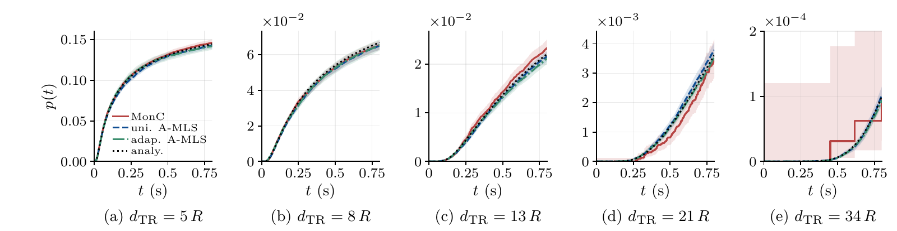

<div align="center">

<h1>A-MLS</h1>

<p><strong>Absorption-Aware Multilevel Splitting for Efficient Rare-Event Simulation in Molecular Communication</strong></p>

<p><em>Manuscript submitted to IEEE ICC 2027 · Decision pending</em></p>

<p>
  <a href="#quick-start">Quick start</a> ·
  <a href="#figures-and-data">Figures and data</a> ·
  <a href="#reproduce-the-experiments">Reproduce the experiments</a> ·
  <a href="README.zh-CN.md">中文说明</a>
</p>

</div>

## A five-minute introduction

**Why absorption is hard to estimate.** In diffusive molecular communication, few molecules reach a distant receiver within the observation window. Direct Monte Carlo (MonC) therefore needs many trajectories to estimate the absorption probability curve.

**How A-MLS works.** Absorption-aware multilevel splitting replicates trajectories that advance toward the receiver. It reconstructs the time-dependent absorption probability from weighted first-hitting-time samples. This repository implements two ways to choose the levels.

| Method | How it samples trajectories |
| --- | --- |
| MonC (`monc`) | Simulates independent molecule trajectories directly. |
| Uniform A-MLS (`mls_lb`) | Splits trajectories at equally spaced distance thresholds. |
| Adaptive A-MLS (`ams_mod`) | Updates the thresholds from the trajectories' progress toward the receiver. |

[](outputs/figures/01_canonical_CDF.pdf)

*Canonical absorption probability curves from one batch of 32 estimates per method and distance. The shaded regions show 95% pointwise confidence intervals. Click the figure for the PDF.*

The archive covers the canonical point-to-sphere channel and four extensions with a reflecting obstacle or a competing absorbing receiver. It includes the simulation results, seeds, FEM reference curves for the extended scenes, and scripts to rebuild the numerical figures and tables.

## Quick start

```bash
git clone https://github.com/J-F-Sun/A-MLS.git
cd A-MLS
```

### Rebuild figures from the supplied data

Use Bash on Linux, macOS, or WSL, Python 3.11 or newer, and a TeX installation with `latex`, `pdflatex`, `dvipng`, `amsmath`, and Computer Modern fonts. The [Matplotlib TeX guide](https://matplotlib.org/stable/users/explain/text/usetex.html) lists the additional packages used by its text renderer.

```bash
python3 -m venv .venv
source .venv/bin/activate
python -m pip install -r requirements.txt
PYTHON_BIN=python bash reproduce_figures.sh
```

The four PDFs and their statistics are written to `outputs/reproduced/`. To rebuild just the statistics and tables with Python's standard library, run `python3 tools/analyze.py --output-root outputs/reproduced/statistics`.

### Preview the simulation plan

The runner requires Julia 1.11 or newer. Julia **1.11.8** is recommended for replaying the archived seeds. The particle simulator uses Julia standard libraries and the supplied reference curves.

```bash
julia --project=. -e 'using Pkg; Pkg.instantiate()'
bash run_simulations.sh --dry-run
```

The dry run lists **138 configurations, 5,445 batches, and 174,240 estimator runs** without starting the simulations.

## Figures and data

| Numerical result | Data | PDF or table |
| --- | --- | --- |
| Sensitivity to level partitioning | [Uniform scan](outputs/canonical/scans/uniform/README.md) · [Adaptive scan](outputs/canonical/scans/adaptive/README.md) | [Parameter sensitivity](outputs/figures/parameter_search_S.pdf) |
| Canonical absorption curves | [Single-experiment CDF data](outputs/canonical/cdf/README.md) | [Canonical CDF](outputs/figures/01_canonical_CDF.pdf) |
| Canonical performance | [Canonical main comparison](outputs/canonical/README.md) | [Performance metrics](outputs/figures/02_canonical_metrics_2x2.pdf) |
| Performance in extended scenes | [Ext1](outputs/ob_complete/README.md) · [Ext2](outputs/ob_half/README.md) · [Ext3](outputs/rx2_competitive/README.md) · [Ext4](outputs/rx2_half/README.md) | [Relative gain](outputs/figures/03_extended_gain_2x2.pdf) · [Performance table](outputs/analysis/extended_performance.tex) |

The [dataset index](outputs/README.md) describes the archive and its fields. The canonical scene uses an analytical reference. The extended scenes use the supplied FEM reference curves as inputs for interpolation onto the simulation time grid. FEM meshes, solver projects, and reference generation are outside the scope of this archive.

## Reproduce the experiments

<details>
<summary>Simulation commands, options, and resuming</summary>

Run these commands from the repository root after setting up Julia.

```bash
# Full manuscript experiment suite
THREADS=32 JOBS=2 bash run_simulations.sh

# Main comparison only
THREADS=32 JOBS=2 bash run_simulations.sh --study main

# Compare the three methods at 34 μm in the canonical scene
THREADS=32 JOBS=2 bash run_simulations.sh \
  --study main --scenes canonical --distances 34

# Replay the CDF and the two parameter scans
bash run_simulations.sh --study cdf
bash run_simulations.sh --study uniform-scan
bash run_simulations.sh --study adaptive-scan
```

- `JULIA_BIN` selects the Julia executable. `THREADS` sets threads per worker and `JOBS` sets the maximum number of concurrent A-MLS workers. Defaults are 32 threads and two A-MLS workers. MonC runs with one worker.
- `--scenes`, `--distances`, and `--methods monc,mls_lb,ams_mod` select subsets. Use `--parameters` to select scan settings and `--experiments` and `--repeats` to take the first recorded batches and estimates. `--steps` changes the time grid while keeping the 0.8 s horizon.
- Outputs default to `outputs/rerun/`. Use `--output-root PATH` for another destination. Keep the supplied seeds and FEM references under `outputs/`, where the runner reads them.
- Repeat the same command to resume a run. The runner checks each saved batch against its settings, code, and checksums. Use a new output root when changing the source, configuration, Julia version, thread count, or other run settings. Seed replay can differ across Julia versions or implementations.

</details>

<details>
<summary>Analyze or plot new simulation results</summary>

```bash
# Summarize a complete or reduced main comparison
python3 tools/analyze.py --data-root outputs/rerun

# Rebuild all four figures from a complete rerun
PYTHON_BIN=python bash reproduce_figures.sh outputs/rerun outputs/rerun/figures

# Plot the complete scans or CDF separately
python tools/plot_parameters.py --data-root outputs/rerun
python tools/plot_cdf.py --data-root outputs/rerun
```

Use the Python and TeX setup from [Quick start](#quick-start) for plotting. The figure script takes the input data root and output directory as optional positional arguments. The full figure set uses the five scenes at five distances for all three methods, 50 batches of 32 estimates for each main comparison, both complete parameter scans, and all five distances for the canonical CDF experiment.

`analyze.py` reads only the main comparison. The scan and CDF scripts use their own inputs and default to writing under `outputs/reproduced/`. Pass `--output PATH.pdf` to change their destinations. The plots use the manuscript's axes and annotations, so new timings or estimates may require adjusting the axes.

</details>

## Recorded data and rerun format

<details>
<summary>Archive files and the per-batch output layout</summary>

The [supplied archive](outputs/README.md) contains `experiments.csv`, `seeds.csv`, `inner_estimates.csv.gz`, and compressed display curves. The scans retain batch summaries and seeds.

New runs save each batch under `<output-root>/<scene>/<study>/runs/<method>/dXXR/p<parameter>/eXX/`. The study directory is `main`, `cdf`, `scans/uniform`, or `scans/adaptive`.

| File | Contents |
| --- | --- |
| `experiment.csv` | Batch summary, full-grid error, and measured wall time |
| `curves.csv` | Reference, mean, standard deviation, confidence bounds, and individual estimates on the display grid |
| `repeats.csv` | Seeds, errors, work counters, and elapsed times for individual estimates |
| `taus.csv` | Recorded target-hit times, one row per hit in each estimate |
| `run.toml` | Source and settings fingerprint plus output checksums for resuming |

The runner gathers completed batches in `<scene>/<study>/experiments.csv`. The analysis and plotting scripts read this layout. The CDF plot reads each batch's `curves.csv` directly.

</details>

## Experimental protocol

<details>
<summary>Parameters, statistics, and implementation</summary>

| Setting | Value |
| --- | --- |
| Receiver radius and diffusivity | 1 μm and 79.4 μm²/s |
| Time grid | 200,000 steps of 4 μs over 0.8 s |
| Transmitter–receiver distance | 5, 8, 13, 21, and 34 μm |
| Particles per estimate | 1,000 molecules for MonC and 250 initial replicas for A-MLS |
| Main comparisons | 50 batches × 32 independently seeded estimates per method, scene, and distance |
| A-MLS levels in the main comparisons | 32 threshold points (`L=31`) for uniform A-MLS and `k=5` for adaptive A-MLS |
| Canonical parameter scans | At 5, 13, and 34 μm. Uniform uses 50 × 32 estimates per setting. Adaptive uses 20 × 32. |
| Canonical CDF | One batch of 32 estimates per method and distance, with separate archived seeds |

Each batch's relative L2 error compares its mean curve to the reference on the full **200,001-point** grid. Display curves use 1,001 points. The main score is `S = mean(wall_seconds) × mean(relative_l2)`. The gain in percent is `100 × (S_MonC / S_A-MLS − 1)`.

The parameter scans and canonical error, wall time, and S plots use 95% percentile bootstrap intervals. The gain panels show point estimates. For the CDF, MonC uses pooled-molecule Wilson intervals and A-MLS uses Student-t intervals across 32 estimates. CSV times are in seconds. Probabilities and relative errors are dimensionless.

The archived times measure threaded estimator batches after warm-up on an Intel Xeon Gold 6430 with Julia 1.11.8, 32 threads per worker, one MonC worker, and two A-MLS workers. Use the supplied timings to reconstruct the manuscript's performance figures. New timings depend on hardware, Julia version, concurrency, and scheduling.

All methods share Gaussian diffusion steps and check absorption at step endpoints. Reflecting spheres use straight-segment intersection and specular reflection of the remaining displacement. These rules approximate the continuous diffusion model with a finite time step. The adaptive implementation removes ties at the selected score, updates weights from the actual surviving fraction, and replays parent RNG streams to recover checkpoints. Target hits retain their original times.

The Julia kernels use SI units. Scene distances, radii, and transverse offsets are multiples of R. The historical keys `obstacle_offset_x_R` and `competitor_offset_x_R` encode a fraction of the transmitter–receiver distance. A value of `0.5` places the additional sphere at x=d/2.

</details>

## Repository layout

| Path | Contents |
| --- | --- |
| [`src/`](src/) | Julia simulation kernels and experiment runner |
| [`config/`](config/) | Physical parameters and scene definitions |
| [`tools/`](tools/) | Python statistics and plotting scripts |
| [`outputs/`](outputs/README.md) | Archived data, reference curves, statistics, and figure PDFs |
| [`run_simulations.sh`](run_simulations.sh) | Simulation entry point |
| [`reproduce_figures.sh`](reproduce_figures.sh) | Figure and table reconstruction |

When referencing the code or data, include the [repository URL](https://github.com/J-F-Sun/A-MLS) and the commit you used.
