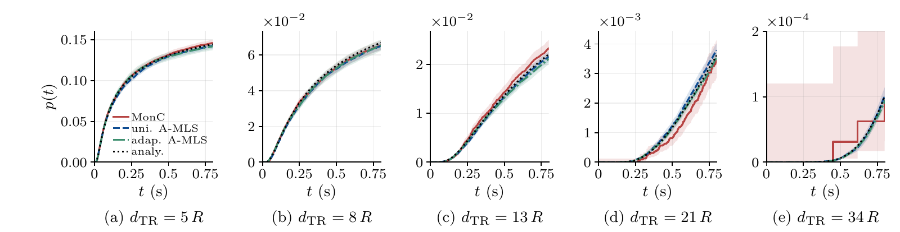

<div align="center">

<h1>A-MLS</h1>

<p><strong>吸收感知多级分裂，用于分子通信中的高效稀有事件仿真</strong></p>

<p><em>论文已投稿至 IEEE ICC 2027 · 审稿结果待定</em></p>

<p>
  <a href="#快速上手">快速上手</a> ·
  <a href="#图表与数据">图表与数据</a> ·
  <a href="#复现实验">复现实验</a> ·
  <a href="README.md">English</a>
</p>

</div>

## 五分钟了解 A-MLS

**为什么吸收概率难估计。** 在扩散分子通信中，距离较远时，只有少量分子能在观测时域内抵达接收器。要估计整条吸收概率曲线，直接蒙特卡洛（MonC）往往需要模拟大量轨迹。

**A-MLS 如何估计。** 吸收感知多级分裂（Absorption-Aware Multilevel Splitting）复制已向接收器推进的轨迹，再利用带权重的首次命中时刻重建随时间变化的吸收概率。程序实现了两种分层策略。

| 方法 | 如何采样轨迹 |
| --- | --- |
| MonC（`monc`） | 直接模拟相互独立的分子轨迹。 |
| 均匀 A-MLS（`mls_lb`） | 采用等间距的距离阈值进行轨迹分裂。 |
| 自适应 A-MLS（`ams_mod`） | 根据轨迹朝向接收器的推进程度更新阈值。 |

[](outputs/figures/01_canonical_CDF.pdf)

*标准场景的吸收概率曲线。每种方法在每个距离展示一批 32 次估计，阴影表示 95% 点态置信区间。点击图像可打开 PDF。*

仓库覆盖标准点到球场景，以及带反射障碍球或竞争吸收球的四个扩展场景。随附仿真结果、随机种子、扩展场景的 FEM 参考曲线，以及重建数值图表所需的脚本。

## 快速上手

```bash
git clone https://github.com/J-F-Sun/A-MLS.git
cd A-MLS
```

### 用随附数据重建图表

需要 Linux、macOS 或 WSL 下的 Bash、Python 3.11 或更新版本，以及提供 `latex`、`pdflatex`、`dvipng`、`amsmath` 和 Computer Modern 字体的 TeX 环境。TeX 文字渲染所需的其他宏包见 [Matplotlib 指南](https://matplotlib.org/stable/users/explain/text/usetex.html)。

```bash
python3 -m venv .venv
source .venv/bin/activate
python -m pip install -r requirements.txt
PYTHON_BIN=python bash reproduce_figures.sh
```

四幅 PDF 及其统计结果写入 `outputs/reproduced/`。如果只想用 Python 标准库重建统计与表格，运行 `python3 tools/analyze.py --output-root outputs/reproduced/statistics`。

### 预览仿真计划

运行程序要求 Julia 1.11 或更新版本。重放归档种子建议使用 **Julia 1.11.8**。粒子仿真使用 Julia 标准库与随附的参考曲线。

```bash
julia --project=. -e 'using Pkg; Pkg.instantiate()'
bash run_simulations.sh --dry-run
```

预览会列出 **138 个配置、5,445 批实验和 174,240 次估计运行**，不会启动仿真。

## 图表与数据

| 数值结果 | 数据说明 | PDF 或表格 |
| --- | --- | --- |
| 分层参数敏感性 | [均匀阈值扫描](outputs/canonical/scans/uniform/README.zh-CN.md) · [自适应参数扫描](outputs/canonical/scans/adaptive/README.zh-CN.md) | [参数敏感性](outputs/figures/parameter_search_S.pdf) |
| 标准场景吸收概率曲线 | [单次实验 CDF 数据](outputs/canonical/cdf/README.zh-CN.md) | [标准场景 CDF](outputs/figures/01_canonical_CDF.pdf) |
| 标准场景性能 | [标准场景主对照](outputs/canonical/README.zh-CN.md) | [性能指标](outputs/figures/02_canonical_metrics_2x2.pdf) |
| 扩展场景性能 | [Ext1](outputs/ob_complete/README.zh-CN.md) · [Ext2](outputs/ob_half/README.zh-CN.md) · [Ext3](outputs/rx2_competitive/README.zh-CN.md) · [Ext4](outputs/rx2_half/README.zh-CN.md) | [相对增益](outputs/figures/03_extended_gain_2x2.pdf) · [性能表](outputs/analysis/extended_performance.tex) |

[数据索引](outputs/README.zh-CN.md)列出了归档内容和字段。标准场景采用解析参考值，扩展场景将随附的 FEM 参考曲线插值到仿真时间网格。FEM 网格、求解器工程及参考曲线的生成流程不在本归档范围内。

## 复现实验

<details>
<summary>仿真命令、选项与断点续跑</summary>

配置好 Julia 后，在仓库根目录执行以下命令。

```bash
# 运行论文的完整实验
THREADS=32 JOBS=2 bash run_simulations.sh

# 只运行主对照
THREADS=32 JOBS=2 bash run_simulations.sh --study main

# 对比标准场景在 34 μm 下的三种方法
THREADS=32 JOBS=2 bash run_simulations.sh \
  --study main --scenes canonical --distances 34

# 重放 CDF 实验与两组参数扫描
bash run_simulations.sh --study cdf
bash run_simulations.sh --study uniform-scan
bash run_simulations.sh --study adaptive-scan
```

- 用 `JULIA_BIN` 选择 Julia 可执行文件。`THREADS` 控制每个工作进程的线程数，`JOBS` 控制 A-MLS 工作进程的最大并发数。默认每进程 32 线程、两个 A-MLS 并发进程。MonC 使用一个工作进程。
- 用 `--scenes`、`--distances` 和 `--methods monc,mls_lb,ams_mod` 选择任务子集，用 `--parameters` 选择扫描参数。用 `--experiments` 和 `--repeats` 选取已记录的前若干批和批内估计。`--steps` 修改时间网格，观测时域仍为 0.8 s。
- 结果默认写入 `outputs/rerun/`，可用 `--output-root PATH` 改变位置。运行程序从 `outputs/` 读取所附种子和 FEM 参考曲线，请将这些输入文件保留在原处。
- 重复执行相同命令可续跑。程序按运行设置、源码和文件校验和检查已保存的批次。修改代码、配置、Julia 版本、线程数或其他运行设置后，请使用新的输出目录。Julia 版本或实现发生变化时，相同种子也可能产生不同结果。

</details>

<details>
<summary>汇总或绘制新仿真的结果</summary>

```bash
# 汇总完整或部分主对照
python3 tools/analyze.py --data-root outputs/rerun

# 从完整重跑结果重建四幅图
PYTHON_BIN=python bash reproduce_figures.sh outputs/rerun outputs/rerun/figures

# 单独绘制完整扫描或完整 CDF
python tools/plot_parameters.py --data-root outputs/rerun
python tools/plot_cdf.py --data-root outputs/rerun
```

绘图使用[快速上手](#快速上手)中的 Python 和 TeX 环境。绘图脚本的两个可选位置参数依次为输入数据根目录和输出目录。重建全部图表需要五个场景在五个距离、三种方法下各 50 批、每批 32 次估计的主对照结果，两组完整参数扫描，以及标准场景全部五个距离的 CDF 实验。

`analyze.py` 只读取主对照。参数扫描与 CDF 的独立绘图脚本读取各自的输入，默认写入 `outputs/reproduced/`，可用 `--output PATH.pdf` 更改输出位置。图表采用稿件的坐标轴和标注设置，重跑得到的新耗时或估计值可能需要调整坐标轴。

</details>

## 归档数据与重跑格式

<details>
<summary>归档文件及批次输出目录</summary>

[所附归档](outputs/README.zh-CN.md)包含 `experiments.csv`、`seeds.csv`、`inner_estimates.csv.gz` 和压缩的展示曲线。参数扫描归档保留逐批汇总和随机种子。

新仿真的每批结果位于 `<output-root>/<scene>/<study>/runs/<method>/dXXR/p<parameter>/eXX/`。实验目录 `<study>` 为 `main`、`cdf`、`scans/uniform` 或 `scans/adaptive`。

| 文件 | 内容 |
| --- | --- |
| `experiment.csv` | 批次汇总、完整网格误差和墙钟耗时 |
| `curves.csv` | 展示网格上的参考值、均值、标准差、置信区间及各次估计曲线 |
| `repeats.csv` | 逐次估计的种子、误差、计算量和耗时 |
| `taus.csv` | 记录的目标命中时刻，每次估计的每个命中对应一行 |
| `run.toml` | 用于续跑的源码与设置指纹、输出文件校验和 |

程序将完成的批次汇总为 `<scene>/<study>/experiments.csv`。统计和绘图脚本支持重跑格式，CDF 图直接读取对应批次的 `curves.csv`。

</details>

## 实验与统计定义

<details>
<summary>参数、统计口径与数值实现</summary>

| 设置 | 取值 |
| --- | --- |
| 接收球半径与扩散系数 | 1 μm、79.4 μm²/s |
| 时间网格 | 步长 4 μs，共 200,000 步，观测时域 0.8 s |
| 发射点到目标球心的距离 | 5、8、13、21、34 μm |
| 每次估计的粒子数 | MonC 使用 1,000 个分子，A-MLS 使用 250 个初始副本 |
| 主对照 | 每种方法、场景和距离各 50 批，每批 32 次独立种子对应的估计 |
| 主对照的 A-MLS 分层 | 均匀 A-MLS 使用 32 个阈值点（`L=31`），自适应 A-MLS 使用 `k=5` |
| 标准场景参数扫描 | 覆盖 5、13、34 μm。均匀扫描每组 50 × 32 次估计，自适应扫描每组 20 × 32 次。 |
| 标准场景 CDF | 每种方法和距离使用一批 32 次估计，种子单独归档 |

逐批相对 L2 误差由该批平均曲线与参考值在完整的 **200,001 点**网格上计算。展示曲线保留 1,001 个点。主指标为 `S = mean(wall_seconds) × mean(relative_l2)`，相对增益百分数为 `100 × (S_MonC / S_A-MLS − 1)`。

参数扫描，以及标准场景的误差、耗时和 S 图采用 95% 百分位 bootstrap 区间。增益面板展示点估计。CDF 图中 MonC 使用合并分子样本的 Wilson 区间，A-MLS 使用 32 次估计的 Student-t 区间。CSV 时间单位为秒，概率和相对误差均无量纲。

归档耗时测量的是预热后的并行估计批次，使用 Intel Xeon Gold 6430、Julia 1.11.8、每进程 32 线程，MonC 为单进程，A-MLS 为两进程并发。重建稿件性能图时使用随附耗时。重跑耗时取决于硬件、Julia 版本、并发数和调度方式。

三种方法共用高斯扩散步进，在时间步端点判定吸收。反射球使用直线步进段与球面的交点，按镜面规则反射剩余位移。这些规则用有限步长近似连续扩散过程。自适应实现会淘汰所选分数处的并列副本，按实际存活比例更新权重，并重放父轨迹随机流以恢复分支检查点。已被目标吸收的副本保留原始命中时刻。

Julia 内核采用 SI 单位。场景距离、球半径和横向偏移以 R 的倍数给出。历史配置键 `obstacle_offset_x_R` 与 `competitor_offset_x_R` 表示发射点到目标球心距离的比例，`0.5` 对应附加球位于 x=d/2。

</details>

## 目录结构

| 路径 | 内容 |
| --- | --- |
| [`src/`](src/) | Julia 仿真内核与实验运行程序 |
| [`config/`](config/) | 物理参数和场景定义 |
| [`tools/`](tools/) | Python 统计与绘图脚本 |
| [`outputs/`](outputs/README.zh-CN.md) | 归档数据、参考曲线、统计汇总和 PDF 图 |
| [`run_simulations.sh`](run_simulations.sh) | 仿真入口 |
| [`reproduce_figures.sh`](reproduce_figures.sh) | 统计和图表重建入口 |

引用本项目的代码或数据时，请附上[仓库地址](https://github.com/J-F-Sun/A-MLS)与所使用的提交版本。
